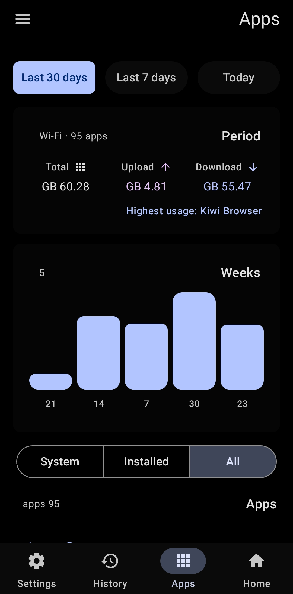
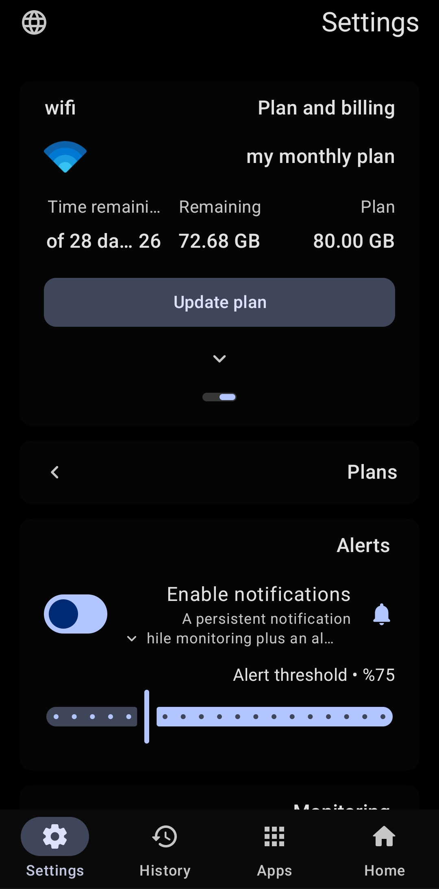

<h2> Wi‑Fi Data Meter</h2>

<strong>Track Wi‑Fi data usage, understand app traffic, and stay ahead of your plan.</strong>

**Early preview · Actively in development · Android 8.0+**

> This is an early preview and may contain bugs or unfinished features. GitHub provides live per-file download totals on the release page; the Downloads badge above is a snapshot.

## Features

- **Usage dashboard:** plan usage, remaining data, cycle days, and upload/download totals.
- **Per-app analytics:** review app data usage with time-period filters, app filters, and sorting.
- **Usage history:** visual charts and summaries for recent days and billing periods.
- **Live floating window:** keep real-time usage visible while using other apps; monitor all apps or a selected app.
- **Internet speed test:** run a speed test and revisit previous results.
- **Background monitoring:** usage notifications, quota alerts, and a home-screen widget.
- **Flexible plans:** set your data allowance and billing-cycle start date.
- **Personalization:** Arabic and English interfaces, plus light and dark themes.

## Screenshots

<table>
  <tr>
    <td align="center"></td>
    <td align="center"></td>
    <td align="center"></td>
    <td align="center"></td>
  </tr>
  <tr>
    <td align="center">Home</td>
    <td align="center">Apps</td>
    <td align="center">History</td>
    <td align="center">Settings</td>
  </tr>
</table>

## Download and compatibility

The release includes a **universal APK** (recommended if you are unsure which file to choose) and ABI-specific builds for **ARM64**, **ARMv7**, **x86_64**, and **x86**.

- [Download the universal APK](https://github.com/my-live-is-a-lie/wifi-data-meter/releases/download/v1.0.1-preview.1/app-universal-release.apk)
- [View the release and all APKs](https://github.com/my-live-is-a-lie/wifi-data-meter/releases/tag/v1.0.1-preview.1)

Per-app usage requires Android's **Usage access** permission. The floating window also requires permission to display over other apps.

## Built with

**Kotlin · Jetpack Compose · Material 3 Expressive.** GitHub Actions builds and signs the release APKs, runs unit tests, and publishes the assets to GitHub Releases. Releases can be started manually, by pushing a `v*` tag, or from an `arena/*` branch with `[publish-release]` in the commit message.
